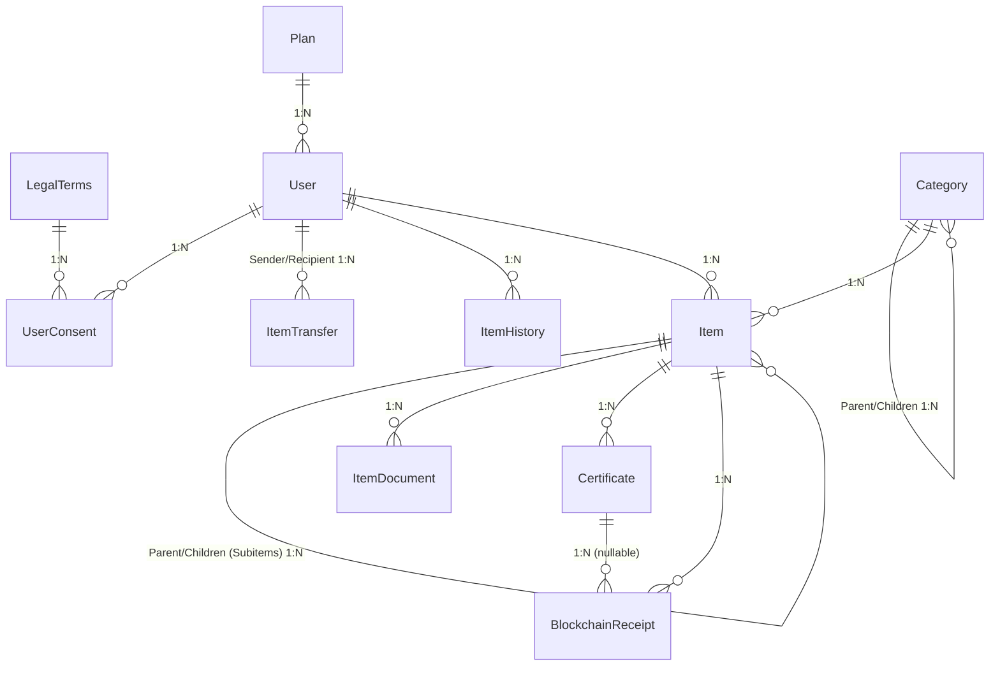
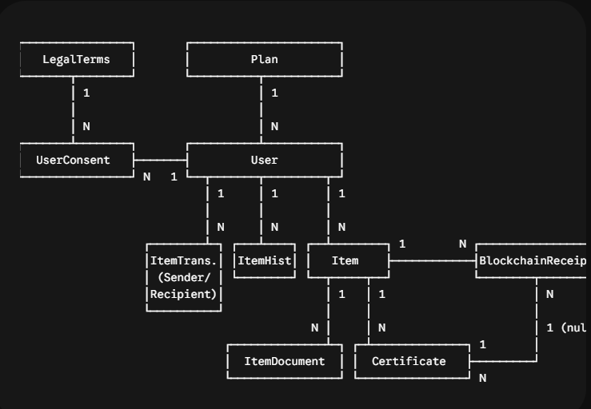

# 3 - Model de Dades Adaptat (Doctrine ORM + MySQL 8.x)

Aquest model incorpora la relació directa entre el bé (Item) i la notarització (BlockchainReceipt), permetent registrar i certificar canvis d'estat de forma independent a l'emissió de documents PDF.

### Diagrama Entitat-Relació Revisat






## 1. Enums PHP Natius (**src/Enum/**)

```php
namespace App\Enum;

enum ItemStatus: string {
    case DRAFT = 'draft';
    case ACTIVE = 'active';
    case TRANSFER_PENDING = 'transfer_pending';
    case TRANSFERRED = 'transferred';
    case STOLEN = 'stolen';
    case LOST = 'lost';
    case ARCHIVED = 'archived';
    case NEEDS_REVIEW = 'needs_review'; // Per a col·leccions d'on s'ha segregat/traspassat un subítem
}

enum AcquisitionType: string {
    case PURCHASE = 'purchase';
    case INHERITANCE = 'inheritance';
    case GIFT = 'gift';
    case PRODUCTION = 'production';
    case OTHER = 'other';
}

enum DocumentType: string {
    case PHOTO_PRIMARY = 'photo_primary';
    case PHOTO_DETAIL = 'photo_detail';
    case INVOICE_RECEIPT = 'invoice_receipt';
    case CERTIFICATE_AUTHENTICITY = 'certificate_authenticity';
    case POLICE_REPORT = 'police_report';
    case LEGAL_DECLARATION = 'legal_declaration';
}
```

## 2. Entitats Principals de Domini

### 2.0. Entitat **Category** (Categories i Subcategories de Béns)

Taula: `categories`

Permet estructurar i catalogar el tipus de bé amb arbre pare/fill (subcategories) i especificar requisits de camps addicionals configurats des del panell d'Admin.

```php
namespace App\Entity;

use Doctrine\Common\Collections\ArrayCollection;
use Doctrine\Common\Collections\Collection;
use Doctrine\ORM\Mapping as ORM;

#[ORM\Entity]
#[ORM\Table(name: 'categories')]
#[ORM\Index(columns: ['slug'], name: 'idx_category_slug')]
class Category
{
    #[ORM\Id]
    #[ORM\GeneratedValue]
    #[ORM\Column(type: 'integer')]
    private ?int $id = null;

    #[ORM\Column(type: 'string', length: 100)]
    private string $name;

    #[ORM\Column(type: 'string', length: 120, unique: true)]
    private string $slug;

    #[ORM\Column(type: 'text', nullable: true)]
    private ?string $description = null;

    #[ORM\Column(type: 'string', length: 60, nullable: true)]
    private ?string $icon = null;

    #[ORM\ManyToOne(targetEntity: self::class, inversedBy: 'children')]
    #[ORM\JoinColumn(name: 'parent_id', referencedColumnName: 'id', nullable: true, onDelete: 'CASCADE')]
    private ?Category $parent = null;

    #[ORM\OneToMany(mappedBy: 'parent', targetEntity: self::class)]
    #[ORM\OrderBy(['sortOrder' => 'ASC', 'name' => 'ASC'])]
    private Collection $children;

    #[ORM\Column(type: 'integer', options: ['default' => 0])]
    private int $sortOrder = 0;

    #[ORM\Column(type: 'boolean', options: ['default' => true])]
    private bool $isActive = true;

    #[ORM\Column(type: 'json', nullable: true)]
    private ?array $customFieldDefinitions = null;

    #[ORM\OneToMany(mappedBy: 'category', targetEntity: Item::class)]
    private Collection $items;
}
```

### 2.1. Entitat **Item** (Bé Moble / Col·lecció / Subítem)

Taula: `items`

Eix central del sistema que enllaça els documents, el cicle de vida, els certificats i les traces a la blockchain. Suporta béns individuals, col·leccions i subítems fills (mitjançant auto-relació `parent_id`).

```php
namespace App\Entity;

use App\Enum\AcquisitionType;
use App\Enum\ItemStatus;
use Doctrine\Common\Collections\ArrayCollection;
use Doctrine\Common\Collections\Collection;
use Doctrine\ORM\Mapping as ORM;
use Symfony\Component\Uid\Uuid;

#[ORM\Entity]
#[ORM\Table(name: 'items')]
#[ORM\Index(columns: ['cui'], name: 'idx_items_cui')]
#[ORM\Index(columns: ['owner_id', 'status'], name: 'idx_items_owner_status')]
#[ORM\Index(columns: ['serial_number'], name: 'idx_items_serial')]
class Item
{
    #[ORM\Id]
    #[ORM\GeneratedValue]
    #[ORM\Column(type: 'integer')]
    private ?int $id = null;

    #[ORM\Column(type: 'uuid', unique: true)]
    private Uuid $uuid;

    #[ORM\Column(type: 'string', length: 32, unique: true)]
    private string $cui; // REG-2026-XXXXXX

    #[ORM\ManyToOne(targetEntity: User::class, inversedBy: 'items')]
    #[ORM\JoinColumn(name: 'owner_id', referencedColumnName: 'id', nullable: false)]
    private User $owner;

    #[ORM\ManyToOne(targetEntity: Category::class, inversedBy: 'items')]
    #[ORM\JoinColumn(name: 'category_id', referencedColumnName: 'id', nullable: false)]
    private Category $category;

    #[ORM\ManyToOne(targetEntity: Category::class)]
    #[ORM\JoinColumn(name: 'subcategory_id', referencedColumnName: 'id', nullable: true)]
    private ?Category $subcategory = null;

    #[ORM\Column(type: 'boolean', options: ['default' => false])]
    private bool $isCollection = false;

    #[ORM\ManyToOne(targetEntity: self::class, inversedBy: 'children')]
    #[ORM\JoinColumn(name: 'parent_id', referencedColumnName: 'id', nullable: true, onDelete: 'SET NULL')]
    private ?Item $parent = null;

    #[ORM\OneToMany(mappedBy: 'parent', targetEntity: self::class)]
    private Collection $children;

    #[ORM\Column(type: 'string', length: 200)]
    private string $name;

    #[ORM\Column(type: 'string', length: 100, nullable: true)]
    private ?string $brand = null;

    #[ORM\Column(type: 'string', length: 100, nullable: true)]
    private ?string $model = null;

    #[ORM\Column(type: 'string', length: 150, nullable: true)]
    private ?string $serialNumber = null;

    #[ORM\Column(type: 'bigint', nullable: true)]
    private ?int $declaredValueCents = null; // Moneda base inicial EUR (€) per marc legal UE; parametritzable a nivell d'usuari/admin en fases posteriors (codi ISO 4217).

    #[ORM\Column(type: 'date_immutable', nullable: true)]
    private ?\DateTimeImmutable $acquisitionDate = null;

    #[ORM\Column(type: 'string', length: 30, enumType: AcquisitionType::class)]
    private AcquisitionType $acquisitionType = AcquisitionType::PURCHASE;

    #[ORM\Column(type: 'text', nullable: true)]
    private ?string $acquisitionCircumstances = null;

    #[ORM\Column(type: 'json', nullable: true)]
    private ?array $customAttributes = null;

    #[ORM\Column(type: 'string', length: 30, enumType: ItemStatus::class, options: ['default' => 'active'])]
    private ItemStatus $status = ItemStatus::ACTIVE;

    #[ORM\Column(type: 'datetime_immutable')]
    private \DateTimeImmutable $createdAt;

    #[ORM\Column(type: 'datetime_immutable')]
    private \DateTimeImmutable $updatedAt;

    #[ORM\OneToMany(mappedBy: 'item', targetEntity: ItemDocument::class, cascade: ['persist'])]
    private Collection $documents;

    #[ORM\OneToMany(mappedBy: 'item', targetEntity: Certificate::class)]
    private Collection $certificates;

    #[ORM\OneToMany(mappedBy: 'item', targetEntity: BlockchainReceipt::class, cascade: ['persist'])]
    private Collection $blockchainReceipts;

    public function __construct(User $owner, string $cui, string $name, Category $category)
    {
$this->uuid = Uuid::v7();
$this->owner = $owner;
$this->cui = $cui;
$this->name = $name;
$this->category = $category;
$this->documents = new ArrayCollection();
$this->certificates = new ArrayCollection();
$this->blockchainReceipts = new ArrayCollection();
$this->createdAt = new \DateTimeImmutable();
$this->updatedAt = new \DateTimeImmutable();
}
}

```

### 2.2. Entitat **BlockchainReceipt** (Notarització de l'Ítem i Certificats)

Taula: blockchain_receipts

Permet que cada alta de bé, canvi crític o emissió de certificat tingui la seva pròpia traça immutable a la xarxa Blockchain.

```php
namespace App\Domain\Entity;

use App\Domain\Enum\BlockchainActionType;
use Doctrine\ORM\Mapping as ORM;

#[ORM\Entity]
#[ORM\Table(name: 'blockchain_receipts')]
#[ORM\Index(columns: ['item_id', 'action_type'], name: 'idx_receipt_item_action')]
#[ORM\Index(columns: ['tx_hash'], name: 'idx_receipt_tx')]
class BlockchainReceipt
{
#[ORM\Id]
#[ORM\GeneratedValue]
#[ORM\Column(type: 'integer')]
private ?int $id = null;

#[ORM\ManyToOne(targetEntity: Item::class, inversedBy: 'blockchainReceipts')]
#[ORM\JoinColumn(name: 'item_id', referencedColumnName: 'id', nullable: false, onDelete: 'CASCADE')]
private Item $item;

#[ORM\ManyToOne(targetEntity: Certificate::class)]
#[ORM\JoinColumn(name: 'certificate_id', referencedColumnName: 'id', nullable: true, onDelete: 'SET NULL')]
private ?Certificate $certificate = null;

#[ORM\Column(type: 'string', length: 30, enumType: BlockchainActionType::class)]
private BlockchainActionType $actionType;

#[ORM\Column(type: 'string', length: 50, options: ['default' => 'polygon-pos'])]
private string $network = 'polygon-pos';

#[ORM\Column(type: 'string', length: 42)]
private string $contractAddress; // '0x...'

#[ORM\Column(type: 'string', length: 66)]
private string $txHash; // Hash de la transacció pública a la xarxa

#[ORM\Column(type: 'bigint')]
private int $blockNumber;

#[ORM\Column(type: 'string', length: 64)]
private string $anchoredHash; // SHA-256 transmès al smart contract

#[ORM\Column(type: 'datetime_immutable')]
private \DateTimeImmutable $anchoredAt;

public function __construct(
Item $item,
BlockchainActionType $actionType,
string $contractAddress,
string $txHash,
int $blockNumber,
string $anchoredHash,
?Certificate $certificate = null
) {
$this->item = $item;
$this->actionType = $actionType;
$this->contractAddress = $contractAddress;
$this->txHash = $txHash;
$this->blockNumber = $blockNumber;
$this->anchoredHash = $anchoredHash;
$this->certificate = $certificate;
$this->anchoredAt = new \DateTimeImmutable();
}
}

```

### 2.3. Entitat **Certificate** (Document de Certificació Oficial / Esborrany)

Taula: certificates

Generat sota demanda de l'usuari amb identificador per a consulta pública via QR.

```php
namespace App\Domain\Entity;

use App\Domain\Enum\CertificateMode;
use Doctrine\ORM\Mapping as ORM;
use Symfony\Component\Uid\Uuid;

#[ORM\Entity]
#[ORM\Table(name: 'certificates')]
#[ORM\Index(columns: ['uuid'], name: 'idx_cert_uuid')]
#[ORM\Index(columns: ['certificate_number'], name: 'idx_cert_number')]
class Certificate
{
#[ORM\Id]
#[ORM\GeneratedValue]
#[ORM\Column(type: 'integer')]
private ?int $id = null;

#[ORM\Column(type: 'uuid', unique: true)]
private Uuid $uuid; // Clau de resolució per al codi QR (/verify/{uuid})

#[ORM\ManyToOne(targetEntity: Item::class, inversedBy: 'certificates')]
#[ORM\JoinColumn(name: 'item_id', referencedColumnName: 'id', nullable: false)]
private Item $item;

#[ORM\ManyToOne(targetEntity: User::class)]
#[ORM\JoinColumn(name: 'issued_by_user_id', referencedColumnName: 'id', nullable: false)]
private User $issuedBy;

#[ORM\Column(type: 'string', length: 50, unique: true)]
private string $certificateNumber; // Ex: CERT-2026-000491

#[ORM\Column(type: 'string', length: 20, enumType: CertificateMode::class)]
private CertificateMode $mode;

#[ORM\Column(type: 'string', length: 255)]
private string $pdfFilePath;

#[ORM\Column(type: 'string', length: 64)]
private string $pdfSha256;

#[ORM\Column(type: 'datetime_immutable')]
private \DateTimeImmutable $createdAt;

public function __construct(Item $item, User $issuedBy, string $number, CertificateMode $mode, string $path, string $hash)
{
$this->uuid = Uuid::v7();
$this->item = $item;
$this->issuedBy = $issuedBy;
$this->certificateNumber = $number;
$this->mode = $mode;
$this->pdfFilePath = $path;
$this->pdfSha256 = $hash;
$this->createdAt = new \DateTimeImmutable();
}
}

```

### 2.4. Entitat **ItemDocument** (Fitxers i Metadades IA)

Taula: item_documents

```php
namespace App\Domain\Entity;

use App\Domain\Enum\DocumentType;
use Doctrine\ORM\Mapping as ORM;
use Symfony\Component\Uid\Uuid;

#[ORM\Entity]
#[ORM\Table(name: 'item_documents')]
#[ORM\Index(columns: ['item_id', 'type'], name: 'idx_doc_item_type')]
class ItemDocument
{
#[ORM\Id]
#[ORM\GeneratedValue]
#[ORM\Column(type: 'integer')]
private ?int $id = null;

#[ORM\Column(type: 'uuid', unique: true)]
private Uuid $uuid;

#[ORM\ManyToOne(targetEntity: Item::class, inversedBy: 'documents')]
#[ORM\JoinColumn(nullable: false, onDelete: 'CASCADE')]
private Item $item;

#[ORM\Column(type: 'string', length: 35, enumType: DocumentType::class)]
private DocumentType $type;

#[ORM\Column(type: 'string', length: 255)]
private string $filePath;

#[ORM\Column(type: 'string', length: 150)]
private string $originalFilename;

#[ORM\Column(type: 'string', length: 100)]
private string $mimeType;

#[ORM\Column(type: 'bigint')]
private int $fileSizeBytes;

#[ORM\Column(type: 'string', length: 64)]
private string $sha256Hash;

#[ORM\Column(type: 'json', nullable: true)]
private ?array $aiExtractedData = null; // Extracció d'SGLang

#[ORM\Column(type: 'datetime_immutable')]
private \DateTimeImmutable $createdAt;

public function __construct(Item $item, DocumentType $type, string $filePath, string $originalFilename, string $mimeType, int $size, string $hash)
{
$this->uuid = Uuid::v7();
$this->item = $item;
$this->type = $type;
$this->filePath = $filePath;
$this->originalFilename = $originalFilename;
$this->mimeType = $mimeType;
$this->fileSizeBytes = $size;
$this->sha256Hash = $hash;
$this->createdAt = new \DateTimeImmutable();
}
}

```

### 2.5. Entitat **ItemTransfer** (Traspàs C2C)

Taula: item_transfers

```php
namespace App\Domain\Entity;

use App\Domain\Enum\TransferStatus;
use Doctrine\ORM\Mapping as ORM;

#[ORM\Entity]
#[ORM\Table(name: 'item_transfers')]
#[ORM\Index(columns: ['token'], name: 'idx_transfer_token')]
class ItemTransfer
{
#[ORM\Id]
#[ORM\GeneratedValue]
#[ORM\Column(type: 'integer')]
private ?int $id = null;

#[ORM\ManyToOne(targetEntity: Item::class)]
#[ORM\JoinColumn(nullable: false)]
private Item $item;

#[ORM\ManyToOne(targetEntity: User::class)]
#[ORM\JoinColumn(nullable: false)]
private User $sender;

#[ORM\Column(type: 'string', length: 180)]
private string $recipientEmail;

#[ORM\ManyToOne(targetEntity: User::class)]
#[ORM\JoinColumn(nullable: true)]
private ?User $recipient = null;

#[ORM\Column(type: 'string', length: 64, unique: true)]
private string $token;

#[ORM\Column(type: 'string', length: 25, enumType: TransferStatus::class, options: ['default' => 'pending'])]
private TransferStatus $status = TransferStatus::PENDING;

#[ORM\Column(type: 'integer', options: ['default' => 0])]
private int $transferFeeCents = 0;

#[ORM\Column(type: 'datetime_immutable')]
private \DateTimeImmutable $requestedAt;

#[ORM\Column(type: 'datetime_immutable')]
private \DateTimeImmutable $expiresAt;

#[ORM\Column(type: 'datetime_immutable', nullable: true)]
private ?\DateTimeImmutable $completedAt = null;
}

```

### 2.6. Entitat **User** i Gestió del KYC

Taula: users

```php
namespace App\Domain\Entity;

use App\Domain\Enum\KycStatus;
use Doctrine\Common\Collections\ArrayCollection;
use Doctrine\Common\Collections\Collection;
use Doctrine\ORM\Mapping as ORM;
use Symfony\Component\Security\Core\User\PasswordAuthenticatedUserInterface;
use Symfony\Component\Security\Core\User\UserInterface;
use Symfony\Component\Uid\Uuid;

#[ORM\Entity]
#[ORM\Table(name: 'users')]
#[ORM\Index(columns: ['email'], name: 'idx_users_email')]
#[ORM\Index(columns: ['auth_provider', 'auth_provider_id'], name: 'idx_users_oauth')]
class User implements UserInterface, PasswordAuthenticatedUserInterface
{
#[ORM\Id]
#[ORM\GeneratedValue]
#[ORM\Column(type: 'integer')]
private ?int $id = null;

#[ORM\Column(type: 'uuid', unique: true)]
private Uuid $uuid;

#[ORM\Column(type: 'string', length: 180, unique: true)]
private string $email;

#[ORM\Column(type: 'json')]
private array $roles = ['ROLE_USER'];

#[ORM\Column(type: 'string', length: 255, nullable: true)]
private ?string $password = null;

#[ORM\Column(type: 'string', length: 100)]
private string $firstName;

#[ORM\Column(type: 'string', length: 150)]
private string $lastName;

#[ORM\Column(type: 'string', length: 20, nullable: true)]
private ?string $taxId = null;

#[ORM\Column(type: 'string', length: 20, options: ['default' => 'local'])]
private string $authProvider = 'local';

#[ORM\Column(type: 'string', length: 255, nullable: true)]
private ?string $authProviderId = null;

#[ORM\Column(type: 'string', length: 30, enumType: KycStatus::class, options: ['default' => 'unverified'])]
private KycStatus $kycStatus = KycStatus::UNVERIFIED;

#[ORM\Column(type: 'string', length: 100, nullable: true)]
private ?string $signaturitKycId = null;

#[ORM\Column(type: 'datetime_immutable', nullable: true)]
private ?\DateTimeImmutable $identityVerifiedAt = null;

#[ORM\ManyToOne(targetEntity: Plan::class)]
#[ORM\JoinColumn(name: 'plan_id', referencedColumnName: 'id', nullable: false)]
private Plan $plan;

#[ORM\Column(type: 'datetime_immutable')]
private \DateTimeImmutable $planStartedAt;

#[ORM\Column(type: 'datetime_immutable', nullable: true)]
private ?\DateTimeImmutable $planExpiresAt = null;

#[ORM\Column(type: 'integer', options: ['default' => 0])]
private int $aiUsageCount = 0;

#[ORM\Column(type: 'integer', options: ['default' => 0])]
private int $certificatesIssuedCount = 0;

#[ORM\Column(type: 'integer', options: ['default' => 0])]
private int $lifetimeItemsRegistered = 0;

#[ORM\Column(type: 'datetime_immutable')]
private \DateTimeImmutable $createdAt;

#[ORM\Column(type: 'datetime_immutable')]
private \DateTimeImmutable $updatedAt;

#[ORM\OneToMany(mappedBy: 'owner', targetEntity: Item::class)]
private Collection $items;

public function __construct()
{
$this->uuid = Uuid::v7();
$this->items = new ArrayCollection();
$this->createdAt = new \DateTimeImmutable();
$this->updatedAt = new \DateTimeImmutable();
$this->planStartedAt = new \DateTimeImmutable();
}

public function getUserIdentifier(): string { return $this->email; }
public function getRoles(): array { return array_unique($this->roles); }
public function eraseCredentials(): void {}
public function getPassword(): ?string { return $this->password; }
}

```

### 2.7. Entitat **Plan** (Quotes i Tarifes Parametritzables)

Taula: plans

```php
namespace App\Domain\Entity;

use Doctrine\ORM\Mapping as ORM;

#[ORM\Entity]
#[ORM\Table(name: 'plans')]
class Plan
{
#[ORM\Id]
#[ORM\GeneratedValue]
#[ORM\Column(type: 'integer')]
private ?int $id = null;

#[ORM\Column(type: 'string', length: 50, unique: true)]
private string $code;

#[ORM\Column(type: 'string', length: 100)]
private string $name;

#[ORM\Column(type: 'integer', options: ['default' => 0])]
private int $priceCents = 0;

#[ORM\Column(type: 'string', length: 20)]
private string $billingPeriod = 'yearly';

#[ORM\Column(type: 'integer')]
private int $maxActiveItems = 20;

#[ORM\Column(type: 'integer')]
private int $maxLifetimeItems = 50;

#[ORM\Column(type: 'integer')]
private int $monthlyCertificatesQuota = 0;

#[ORM\Column(type: 'boolean', options: ['default' => false])]
private bool $allowOfficialCertificates = false;

#[ORM\Column(type: 'integer', options: ['default' => 0])]
private int $aiAssistanceQuota = 0;

#[ORM\Column(type: 'integer', options: ['default' => 0])]
private int $transfersIncluded = 0;

#[ORM\Column(type: 'integer', options: ['default' => 200])]
private int $extraTransferPriceCents = 200;

#[ORM\Column(type: 'integer', options: ['default' => 1])]
private int $maxPhotosPerItem = 1;

#[ORM\Column(type: 'integer', options: ['default' => 1])]
private int $maxEvidencesPerItem = 1;

#[ORM\Column(type: 'boolean', options: ['default' => true])]
private bool $isActive = true;

#[ORM\Column(type: 'datetime_immutable')]
private \DateTimeImmutable $createdAt;
}
```

*Regla de Negoci i Backoffice Admin:*
- `maxActiveItems`: FREE: 20 | PLUS: 100 *(configurable a Admin)* | UNLIMITED: -1 (il·limitat).
- `maxPhotosPerItem`: FREE: 1 | PLUS: 5 | UNLIMITED: -1 (il·limitat).
- `maxEvidencesPerItem`: FREE: 1 | PLUS: 5 | UNLIMITED: -1 (il·limitat).
- Totes les quotes han de ser modificables en calent pels administradors des de `/admin/plans` (EasyAdmin / Symfony Form).

---

## 8. Model d'Auditoria & Activitat (Base de Dades Aïllada `registrals_audit`)

Per garantir la immutabilitat forense, protegir el rendiment transaccional del negoci i simplificar les còpies de seguretat independents, el registre d'activitat dels usuaris s'emmagatzema en una base de dades completament independent (`registrals_audit`), gestionada per un segon Entity Manager (`audit`) a Symfony / Doctrine:

- **Connexió Doctrine:** `audit` (`AUDIT_DATABASE_URL`).
- **Entity Manager:** `doctrine.orm.audit_entity_manager` mapejat a `src/Audit/Entity`.
- **Sense claus foranes creuades:** Per evitar dependències entre bases de dades i permetre restauracions independents, s'emmagatzemen com a valors desnormalitzats `user_uuid` (string 36, indexat), `user_email` i `user_name`.

### Entitat `UserActivityLog` (`src/Audit/Entity/UserActivityLog.php`)
- `id`: INTEGER (PK, Auto-increment).
- `user_uuid`: VARCHAR(36) INDEXAT (UUID v7 del compte de l'usuari).
- `user_email`: VARCHAR(180).
- `user_name`: VARCHAR(180).
- `action`: VARCHAR(50) — Enum `UserActivityAction` (`login`, `logout`, `register`, `password_changed`, `item_created`, `item_updated`, `item_deleted`, `status_changed`, `certificate_issued`, `transfer_initiated`, `transfer_accepted`).
- `description`: VARCHAR(255).
- `ip_address`: VARCHAR(45) NULLABLE (IPv4 o IPv6 de la sol·licitud).
- `user_agent`: VARCHAR(255) NULLABLE.
- `details`: JSON NULLABLE (metadades estructurades com firewall, motiu de suspensió, etc.).
- `created_at`: DATETIME INDEXAT (segell de temps immutable UTC).

Aquest model connecta directament l'estat de l'ítem amb el seu cicle de vida i la blockchain.

